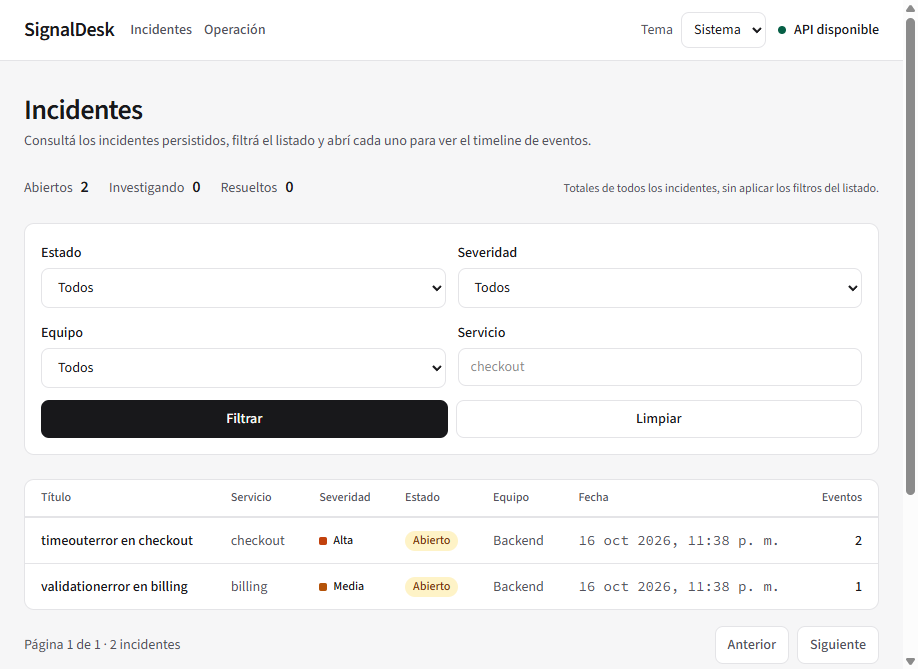
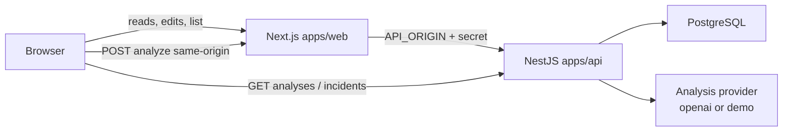

# SignalDesk

Incident console for correlating synthetic error events, investigating open incidents, and generating bounded diagnostic hypotheses. Built as a full-stack portfolio MVP with a public read-mostly demo.

**Live demo:** [https://signaldesk-pearl.vercel.app](https://signaldesk-pearl.vercel.app)  
**Repository:** [https://github.com/AlejandroM12/signaldesk](https://github.com/AlejandroM12/signaldesk)



The public deployment runs NestJS on Render Free, Next.js on Vercel Hobby, and PostgreSQL on Neon Free. Demo analysis uses local deterministic rules (`ANALYSIS_PROVIDER_MODE=demo`). It does **not** call OpenAI.

## Problem and approach

Operational noise rarely arrives as a clean incident. The same timeout can fire many times; edits race; an assistant that invents event IDs is worse than no assistant.

SignalDesk approaches that with a small, verifiable loop:

1. Ingest events with validation, `(source, externalId)` deduplication, and time-window correlation into open incidents.
2. Investigate with optimistic locking, an append-only activity history, and a paginated incident console.
3. Request analysis through a provider interface that validates structured output against the incident’s real event IDs before persistence.
4. Ship a public demo that stays readable while writes and internal metrics are blocked server-side, and analysis is gated by a shared secret on a Next.js proxy.

## Features

- Paginated incident list with status, severity, service, and team filters, plus a global status summary
- Incident detail with chronological events, editable investigation fields (local mode), and activity history
- Event ingest with Zod-style Nest validation (`class-validator`), correlation, and duplicate rejection (`409`)
- Assisted analysis with idempotency keys, leases for concurrent retries, and evidence references constrained to included events
- Public demo mode: read paths and controlled analysis only; ingest, edits, and `/api/metrics` blocked
- Same-origin Next.js proxy for analysis (`POST /api/incidents/:id/analyze`) with body limits, timeouts, and server-only secrets
- In-process metrics snapshot and optional New Relic APM for the API process
- Health (`/api/health`) and readiness (`/api/health/ready`) endpoints

## Tech stack

Verified from workspace manifests:

| Layer | Technology |
| --- | --- |
| Monorepo | pnpm workspaces (`apps/*`, `packages/*`), pnpm `11.25.0`, Node `>=22.22.3` |
| Web | Next.js `16.4.0`, React `19.3.0`, Tailwind CSS `4`, Vitest |
| API | NestJS `12`, Prisma `7.10.0`, PostgreSQL (`pg` adapter), Jest, Supertest, Oxlint |
| Shared | `@signaldesk/contracts` (TypeScript package compiled before web/API) |
| Analysis adapters | OpenAI SDK `7.32.0` (local/openai mode) or deterministic demo rules |
| Observability | Structured request logs, in-memory metrics, optional `newrelic` agent |

## Architecture



```text
apps/web              Next.js UI and analysis proxy route
apps/api              NestJS API, Prisma, providers
packages/contracts    Shared TypeScript contracts
```

## Technical decisions

### Event correlation and deduplication

`POST /api/events` validates the payload, then persists. Deduplication is unique on `(source, externalId)`; a repeat returns `409` without replaying the first result. Correlation attaches an event to an existing `OPEN` or `INVESTIGATING` incident only when **service** and **error type** match and the event timestamp falls within `EVENT_CORRELATION_WINDOW_MINUTES` of the latest matching event (default 30). Closest distance wins; ties prefer the newer incident. Other services or out-of-window events open a new incident.

### Idempotency and concurrency

Analysis accepts an optional `idempotencyKey` (max 80, `[A-Za-z0-9_-]+`). The same key on the same incident reuses a stored analysis without calling the provider again. Concurrent callers coordinate through `AnalysisOperation` rows with leases; a failed operation can be retried with the same key after failure or lease expiry. Incident edits require `expectedUpdatedAt`; a stale value returns `409` and writes nothing. Successful field changes append `IncidentActivity` in the same transaction.

### Activity history

Each mutating update that changes fields writes `UPDATED` activity with before/after values. Failure to write activity rolls back the update. `GET /api/incidents/:id/activity` returns newest first. `actorId` is `null` (no user auth yet).

### Assisted analysis with evidence

The provider receives a bounded incident context and must return structured hypotheses. The API rejects output that cites event IDs outside the included set (`422`). Results are diagnostic aids only: they do not set root cause, resolution, or status. Stored analyses remain readable after new events arrive; the UI can indicate the snapshot may be stale. Public demo retains at most the 25 newest analyses per incident under a Postgres advisory lock.

### Public demo security

With `PUBLIC_DEMO_MODE=true` the API requires `ANALYSIS_PROVIDER_MODE=demo` and a proxy secret (≥16 characters) at boot. A global guard uses path normalization (case, trailing slash, query strip, segment cleanup) and **default-deny for writes**, allowing only `POST .../analyze` among mutating methods, plus an explicit read allowlist. Metrics stay blocked under path variants. The browser never receives `ANALYSIS_PROXY_SECRET` or `API_ORIGIN`. Analysis goes through Next.js, which validates UUID and body, caps size at 1 KB, times out at 8s (`maxDuration` 10 on Vercel), and attaches the secret only server-to-server. Nest verifies the secret with SHA-256 digests and `timingSafeEqual` before quota or provider work. CORS is a single configured origin; it is not authentication. Global analysis quota remains shared (recommended public values: 20 / hour).

### Observability

Every request gets an `X-Request-Id` (client-supplied if valid, otherwise generated). Access logs are JSON with method, Nest route pattern, status, and duration—no bodies, secrets, or prompts. `GET /api/metrics` exposes process-local counters (lost on restart, blocked in public demo). Optional New Relic APM instruments the API when `NEW_RELIC_ENABLED=true` and a license key is present; it does not instrument Next.js.

## OpenAI provider vs demo provider

| | `ANALYSIS_PROVIDER_MODE=openai` | `ANALYSIS_PROVIDER_MODE=demo` |
| --- | --- | --- |
| Network | Calls OpenAI Responses API when `OPENAI_API_KEY` is set | No generative API call |
| Client | OpenAI client constructed only in this mode | Client is not created, even if a key exists |
| Persistence | `provider` / model from OpenAI settings | `provider=demo`, `model=demo-rules-v1` |
| Shared path | Same validation, quota, idempotency, and evidence checks | Same |
| Public demo | Refused at boot if `PUBLIC_DEMO_MODE=true` | Required for public demo |

Missing `OPENAI_API_KEY` does **not** switch the API to demo mode.

## Run locally

Requirements: Node.js `>=22.22.3` (CI uses 24.15.0), pnpm `11.25.0`, Docker with Compose.

```powershell
pnpm install
Copy-Item .env.example .env
pnpm db:up
pnpm db:migrate:deploy
pnpm db:seed
pnpm dev
```

- Web: [http://localhost:3000](http://localhost:3000)
- API: [http://localhost:3001](http://localhost:3001)

Other useful commands:

```powershell
pnpm dev:api
pnpm dev:web
pnpm test
pnpm test:e2e
pnpm lint
pnpm build
pnpm db:down
```

`pnpm db:migrate -- --name <name>` creates a new development migration. Prefer `db:migrate:deploy` when applying existing migrations. Seed data is synthetic and idempotent (`ON CONFLICT DO NOTHING`).

For local OpenAI analysis, set `OPENAI_API_KEY` in `.env` and keep `ANALYSIS_PROVIDER_MODE=openai` (or unset). For a local public-demo style setup, set `PUBLIC_DEMO_MODE=true`, `ANALYSIS_PROVIDER_MODE=demo`, and a long `ANALYSIS_PROXY_SECRET` on both API and web (via root `.env` / Next server env).

## Environment variables

Copy `.env.example` to `.env`. Do not commit real secrets. Only `NEXT_PUBLIC_*` values are exposed to the browser.

| Variable | Used by | Notes |
| --- | --- | --- |
| `PORT` | API | Host-assigned port (e.g. Render). Wins over `API_PORT` when set. |
| `API_PORT` | API | Local Nest port (default `3001`). Listens on `0.0.0.0`. |
| `CORS_ORIGIN` | API | Allowed browser origin. Not authentication. |
| `NEXT_PUBLIC_API_URL` | Web | Public API URL for browser reads. |
| `API_ORIGIN` | Web (server) | Nest origin for the analysis proxy. Production must be `https` without credentials, path, query, or fragment. |
| `ANALYSIS_PROXY_SECRET` | API + Web (server) | Shared analyze secret; required when `PUBLIC_DEMO_MODE=true`. Never use a `NEXT_PUBLIC_` prefix. |
| `POSTGRES_*` | Docker / local | Local Postgres user, password, database, published port. |
| `DATABASE_URL` | API / Prisma | Connection string. Not used by the frontend. Pool max 3 connections per process. |
| `EVENT_CORRELATION_WINDOW_MINUTES` | API | Correlation window (default `30`). |
| `ANALYSIS_PROVIDER_MODE` | API | `openai` or `demo`. |
| `PUBLIC_DEMO_MODE` | API | `true` / `false`. `true` requires demo provider + proxy secret. |
| `OPENAI_API_KEY` | API | Server-only. Required for successful openai-mode analysis. |
| `OPENAI_MODEL` | API | Default `gpt-6-luna`. |
| `OPENAI_TIMEOUT_MS` | API | Default `20000`. |
| `OPENAI_MAX_OUTPUT_TOKENS` | API | Default `1200`. |
| `OPENAI_REASONING_EFFORT` | API | Default `none`. |
| `ANALYSIS_RATE_LIMIT` | API | Global new-analysis cap (local default `10`). |
| `ANALYSIS_RATE_WINDOW_MS` | API | Cap window in ms (local default `60000`). Public demo recommendation: `20` / `3600000`. |
| `NEW_RELIC_ENABLED` | API | Must be exactly `true` to start the agent. |
| `NEW_RELIC_APP_NAME` | API | Expected `SignalDesk-API`. |
| `NEW_RELIC_LICENSE_KEY` | API | Server-only license key. |

## Testing and CI

- API unit tests: Jest (`pnpm test`)
- API e2e tests: Jest + Supertest against local PostgreSQL (`pnpm test:e2e`, sequential workers to avoid races on shared `AnalysisRateState`)
- Web tests: Vitest (`pnpm --filter @signaldesk/web test`)
- Lint: Oxlint (API), ESLint (web)
- GitHub Actions (`.github/workflows/ci.yml`): install, build contracts, Prisma generate, lint, unit tests, frontend tests, build; separate job applies migrations and runs e2e on Postgres 18

## Known MVP limitations

- No end-user authentication or multi-tenant isolation; the public demo is a shared dataset
- Analysis quota is global to the API process/database row, not per visitor or IP
- `CORS_ORIGIN` restricts browsers only; non-browser clients can still call the API if reachable
- In-memory metrics are per process and are cleared on restart
- Optimistic locking and analysis leases reduce races but do not eliminate every duplicate external provider call after crashes
- Correlation never merges different services; multiple open incidents can exist for the same service and error type outside the window
- `CLOSED` exists in the model but the current edit cycle does not transition into or out of it
- New Relic is optional and API-only; browser monitoring is off
- Free-tier hosts may cold-start; the analysis proxy times out at 8 seconds
